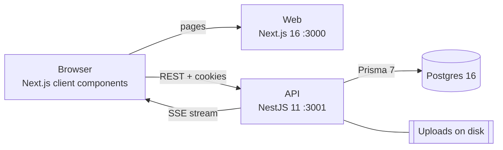

# Twitter Clone

A full-stack social feed in the spirit of Twitter, built with Next.js, NestJS and Postgres. You can post text and images, follow people, like, retweet and reply, make your account private, and get notified in real time when someone interacts with you.

It runs locally with one Docker Compose command.

## Highlights

- **Real-time notifications over Server-Sent Events.** Likes, comments, replies, retweets, follows and follow requests are pushed to the bell in the nav as they happen. The stream ends when the access token expires, and the client re-authenticates through the refresh flow and reconnects with backoff, picking up anything it missed while disconnected.
- **Private accounts with follow requests.** A private account's posts, retweets included, are visible only to approved followers. Requests are accepted or declined straight from the notifications inbox, and switching back to public accepts every pending request in one database transaction.
- **One visibility rule for the whole app.** Who can see a post is decided in a single Prisma filter that every feed, profile, count and single-post check uses, so a privacy change can't be missed in one corner of the app.
- **Security hardening.** Uploads are validated by their file signature, private posts can't leak through retweets, password and email changes need the current password and revoke other sessions, and credential endpoints are rate limited. The full list is below.
- **Tested.** The API has 97 unit tests across services, visibility rules, uploads and the notification stream.

## Features

**Posting**
- Text posts up to 280 characters with an optional image
- Edit a post's text, image and visibility, or delete it
- Per-post visibility: public, or followers only
- A page for every post with all of its comments

**Social**
- Like, retweet and reply, with one level of threaded replies
- Follow and unfollow, with an "All" and a "Following" feed
- Infinite scroll on feeds and profiles
- Search users by username or display name

**Privacy**
- Private accounts: non-followers see the profile header and a "This account is private" card
- Follow requests with Accept and Decline in the inbox
- Comments can be deleted by their author or by the post's author

**Notifications**
- Live bell with an unread badge, a dropdown of the newest items and a full inbox page
- Undoing an action (unlike, unfollow, deleting a comment) removes its notification

**Accounts**
- Register and log in with a username or email
- Profile with display name, bio and avatar
- Change email or password with the current password
- Light and dark theme without a flash on load

## Architecture



- The browser loads pages from Next.js and talks to the NestJS API directly with httpOnly cookies.
- Auth uses a 15-minute access token and a 7-day refresh token. A `tokenVersion` on each user lets a password change revoke every other session.
- Notifications are written by the posts and follows services and published to a per-user RxJS stream, which the SSE endpoint forwards to that user's open tabs. The stream is in memory, which suits a single API instance.
- Uploaded images are stored on disk and served by the API with `nosniff` and a sandbox CSP. A file is deleted once no post or avatar references it.
- Database changes are versioned Prisma migrations, applied by a one-shot `migrate` container before the API starts.

## Tech Stack

- **Web:** Next.js 16 (App Router), React 19, Tailwind CSS 4, TypeScript
- **API:** NestJS 11, Prisma 7, class-validator, RxJS, `@nestjs/throttler`
- **Database:** Postgres 16
- **Tooling:** Docker Compose, Jest, ESLint, Prettier

## Security

- Image uploads are checked by magic bytes, capped at 5MB while streaming, and never trusted by filename or MIME type
- Post images and avatars must point at files this API stored
- A private post or a private account's posts never reach non-followers, directly or through retweets
- Usernames are limited to letters, numbers and underscores
- Email and password changes require the current password, and a password change signs out other sessions
- Login, register, profile updates and uploads are rate limited
- Login takes the same time whether or not the account exists
- The notification stream closes when the access token expires, so a logged-out session can't keep listening

## Running Locally

You need Docker Desktop (or Docker Engine) running.

1. Copy `.env.example` to `.env` in the repo root.
2. Replace both JWT secrets with long random strings, for example the output of `openssl rand -hex 32`.
3. From the repo root, run:
   ```bash
   docker compose up --build
   ```
4. Open `http://localhost:3000` for the app. The API is at `http://localhost:3001/api`.

Create an account to post and interact. Signed-out visitors can browse public posts and profiles.

The default `.env.example` values:

```
# Database
POSTGRES_USER=postgres
POSTGRES_PASSWORD=postgres
POSTGRES_DB=project_db
POSTGRES_PORT=5432
DATABASE_URL=postgresql://postgres:postgres@db:5432/project_db

# API
API_PORT=3001
PORT=3001
API_BASE_URL=http://localhost:3001
WEB_ORIGIN=http://localhost:3000
JWT_ACCESS_SECRET=replace-with-secure-random-string
JWT_REFRESH_SECRET=replace-with-secure-random-string

# Web
WEB_PORT=3000
NEXT_PUBLIC_API_BASE_URL=http://localhost:3001
```

## Tests

```bash
cd apps/api
npm install
npm test
```

## Project Structure

```
apps/
  api/                 NestJS API
    prisma/            schema and migrations
    src/
      auth/            cookies, JWT guards, login, refresh
      posts/           posts, comments, likes, retweets, visibility rule
      users/           profiles, search, follows and follow requests
      notifications/   notification service, stream and SSE endpoint
      uploads/         image upload, validation and cleanup
  web/                 Next.js app
    src/
      app/             routes: feed, post, user, notifications, settings
      components/      post list, profile header, notification bell
      context/         auth, theme and live notifications state
      lib/             API client
docker-compose.yml     db, migrate, api and web services
```

The [API README](apps/api/README.md) lists every endpoint, and the [web README](apps/web/README.md) covers routes and frontend notes.

## Media

The `/media` folder has a walkthrough video and database screenshots from an earlier version of the app, before notifications and private accounts were added.

## Possible Next Steps

- Direct messages on top of the existing real-time stream
- Live like and retweet counts in the feed
- Grouped notifications, like "Ana and 4 others liked your post"
- Video uploads
- Frontend tests with Playwright
